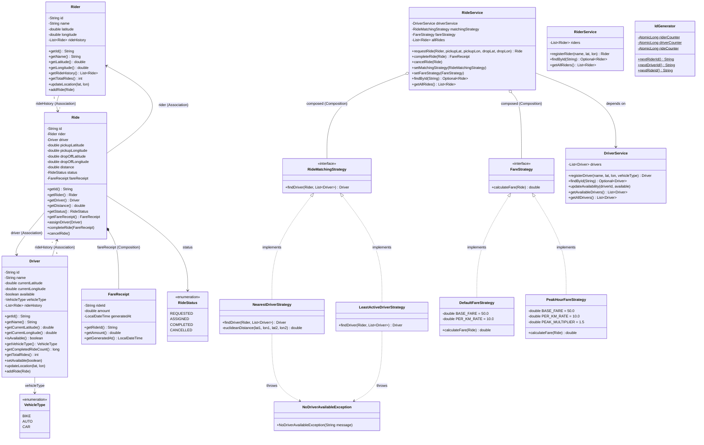

# RideWise — Class Model

## Class Diagram

---

## Entity Summary

| Entity        | Package   | Type        | Purpose                                    |
|---------------|-----------|-------------|--------------------------------------------|
| `Rider`       | `model`   | Class       | Represents a passenger with ride history   |
| `Driver`      | `model`   | Class       | Represents a driver with availability and vehicle type |
| `Ride`        | `model`   | Class       | Represents a trip with validated state machine |
| `FareReceipt` | `model`   | Value Object| Immutable fare breakdown for a completed ride |
| `RideStatus`  | `model`   | Enum        | Life-cycle states: REQUESTED → ASSIGNED → COMPLETED / CANCELLED |
| `VehicleType` | `model`   | Enum        | BIKE, AUTO, CAR                            |

---

## Key Design Decisions

| Decision | Rationale |
|----------|-----------|
| `FareReceipt` is immutable | Value object — once calculated, a receipt never changes |
| `FareStrategy` returns `double`, not `FareReceipt` | Strategy is purely about pricing logic; the service builds the receipt (SRP) |
| `Ride` validates its own state transitions | High cohesion — the entity that owns the state enforces its rules |
| Strategies are interfaces, not abstract classes | Composition over inheritance — allows multiple independent strategy dimensions |
| `RideService` takes strategies via constructor | Constructor injection (Spring DI) enables testability and explicit dependencies |
| `VehicleType` is an enum on `Driver` | Extensible for future fare logic without modifying existing strategies (OCP) |
| `IdGenerator` uses `AtomicLong` | Thread-safe ID generation without synchronization overhead |
| Ride history returns unmodifiable lists | Prevents external mutation of internal state (Law of Demeter) |
