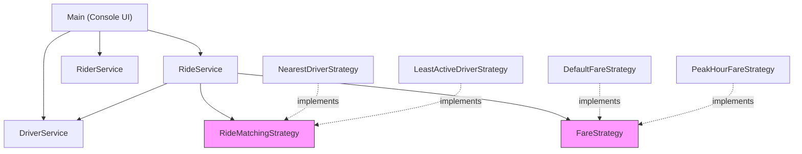

# RideWise — Object Relationships

A detailed breakdown of every relationship in the system, why each type was chosen, and how design principles are enforced.

---

## Relationship Map

| From → To | Relationship Type | Explanation |
|-----------|-------------------|-------------|
| `Rider` → `Ride` | **Association** | A rider has many rides over time, but rides exist independently |
| `Driver` → `Ride` | **Association** | A driver has many rides, but neither owns the other |
| `Ride` → `Rider` | **Association** | A ride references its rider, but doesn't own it |
| `Ride` → `Driver` | **Association** | A ride references its assigned driver |
| `Ride` → `FareReceipt` | **Composition** | A `FareReceipt` belongs to exactly one `Ride`. It has no meaning outside the ride — if the ride is destroyed, so is the receipt |
| `Ride` → `RideStatus` | **Association** | A ride has a status from the `RideStatus` enum |
| `Driver` → `VehicleType` | **Association** | A driver has a vehicle type from the `VehicleType` enum |
| `RideService` → `RideMatchingStrategy` | **Composition** | `RideService` owns and delegates matching decisions to this strategy |
| `RideService` → `FareStrategy` | **Composition** | `RideService` owns and delegates fare calculations to this strategy |
| `RideService` → `DriverService` | **Dependency** | `RideService` calls `DriverService` to query available drivers |

---

## Composition vs. Inheritance

This project deliberately uses **composition over inheritance**.

### ❌ What we avoided (inheritance-based)

```java
// BAD: Strategies as subclasses of RideService
abstract class RideService {
    abstract Driver findDriver(Rider rider, List<Driver> drivers);
    abstract double calculateFare(Ride ride);
}

class NearestDefaultRideService extends RideService { ... }
class NearestPeakRideService extends RideService { ... }
class LeastActiveDefaultRideService extends RideService { ... }
class LeastActivePeakRideService extends RideService { ... }

// Combinatorial explosion: N matching × M fare = N×M subclasses!
// 2 × 2 = 4 subclasses now, but 5 × 5 = 25 subclasses later
```

### ✅ What we did (composition-based)

```java
// GOOD: Strategies as pluggable interfaces
@Service
public class RideService {
    private RideMatchingStrategy matchingStrategy;  // injected
    private FareStrategy fareStrategy;              // injected

    // Can mix and match any combination freely
    // 2 matching + 2 fare = 4 classes total (not 4 subclasses!)
    // 5 matching + 5 fare = 10 classes total (not 25!)
}
```

### Growth comparison

| # Matching Strategies | # Fare Strategies | Inheritance Approach | Composition Approach |
|:---------------------:|:-----------------:|:--------------------:|:--------------------:|
| 2 | 2 | 4 subclasses | **4 classes** |
| 3 | 3 | 9 subclasses | **6 classes** |
| 5 | 5 | 25 subclasses | **10 classes** |

---

## Composition: Ride → FareReceipt

The `FareReceipt` is **composed** within `Ride` (not just associated):

```java
public class Ride {
    private FareReceipt fareReceipt;  // Composition — owned by this Ride

    public void completeRide(FareReceipt fareReceipt) {
        this.fareReceipt = fareReceipt;    // receipt is created FOR this ride
        this.status = RideStatus.COMPLETED;
    }
}
```

**Why composition?**
- A `FareReceipt` has no identity outside its ride
- It's created only when the ride completes
- Its `rideId` field ties it permanently to one ride
- If the ride were deleted, the receipt would be meaningless

---

## Composition: RideService → Strategies

```java
@Service
public class RideService {
    private RideMatchingStrategy matchingStrategy;  // Composition
    private FareStrategy fareStrategy;              // Composition

    public Ride requestRide(Rider rider, ...) {
        // Delegates to matchingStrategy — doesn't implement matching itself
        Driver driver = matchingStrategy.findDriver(rider, availableDrivers);
        ...
    }

    public FareReceipt completeRide(Ride ride) {
        // Delegates to fareStrategy — doesn't implement pricing itself
        double amount = fareStrategy.calculateFare(ride);
        ...
    }
}
```

**Why this is composition:**
- `RideService` owns the strategies and manages their lifecycle
- The strategies are injected (swappable) but always present
- `RideService` delegates behavior to them — it has no matching or pricing logic of its own

---

## Law of Demeter

> *"Only talk to your immediate friends."*

### ✅ Applied correctly

```java
// RideService talks to its direct dependency — NOT reaching through it
List<Driver> available = driverService.getAvailableDrivers();
Driver driver = matchingStrategy.findDriver(rider, available);
```

```java
// Rider exposes derived state — callers don't dig through internal lists
rider.getTotalRides();  // ✅ asks, doesn't compute
// NOT: rider.getRideHistory().stream().filter(...).count();  ❌
```

```java
// Driver exposes a derived count — single source of truth
driver.getCompletedRideCount();  // ✅ encapsulated
// NOT: driver.getRideHistory().stream()
//          .filter(r -> r.getStatus() == COMPLETED).count();  ❌
```

### Unmodifiable views prevent mutation through references

```java
public List<Ride> getRideHistory() {
    return Collections.unmodifiableList(rideHistory);  // ✅ caller can read but not mutate
}
```

---

## Low Coupling / High Cohesion

### Low Coupling

| Evidence | Explanation |
|----------|-------------|
| `RideService` → `RideMatchingStrategy` | Knows only the **interface**, not which algorithm runs |
| `RideService` → `FareStrategy` | Knows only the **interface**, not the pricing model |
| `NearestDriverStrategy` | Knows nothing about fares, rides, or services — only selects a driver |
| `DefaultFareStrategy` | Knows nothing about matching, drivers, or services — only computes a price |
| `RiderService` | Completely independent — has zero dependencies on other services |

### High Cohesion

| Class | Why It's Cohesive |
|-------|------------------|
| `Ride` | All ride-related state **and** state-transition validation lives here |
| `FareReceipt` | Focused value object with only fare-related fields (`rideId`, `amount`, `generatedAt`) |
| `Driver` | All driver concerns: location, availability, vehicle type, ride history |
| `RideService` | All ride life-cycle orchestration: request, assign, complete, cancel |

---

## Dependency Graph



> Pink nodes are **interfaces** — the abstraction boundaries that decouple the system.
